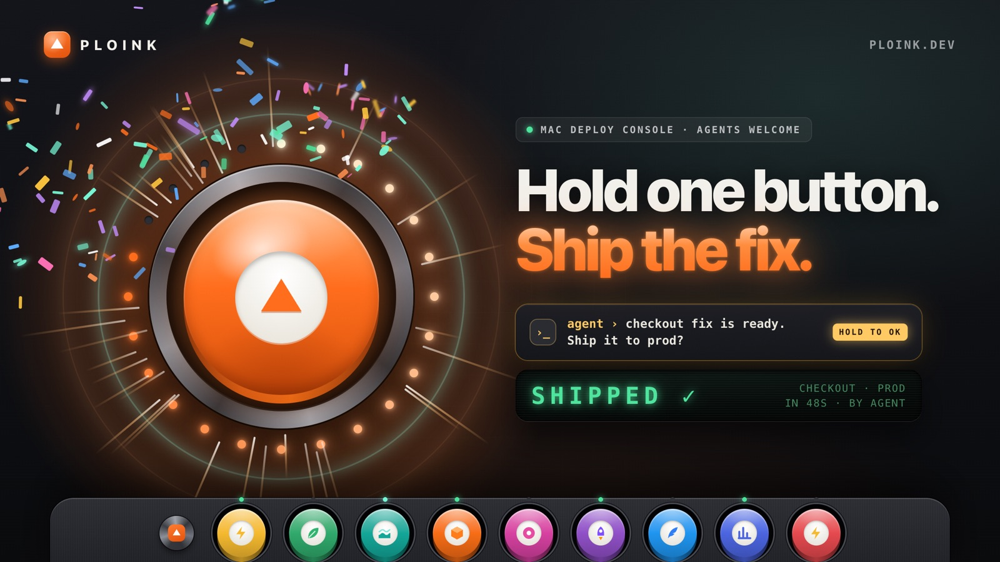
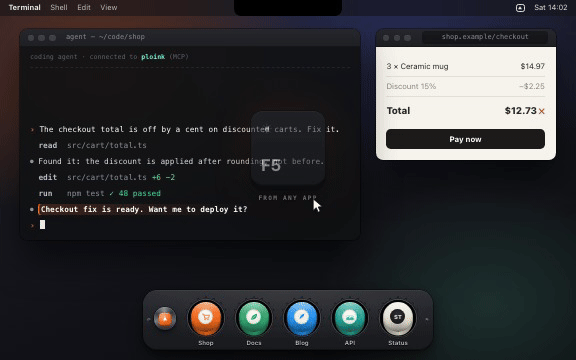

<p align="center"></p>

# Ploink

**Hold one button. Ship the fix.**

[ploink.dev](https://ploink.dev) · [Ploink Pro](https://vizzmo.gumroad.com/l/ploink) · MIT licensed · macOS (Apple Silicon)

A deploy console for your Mac. Each project gets a big, physical-feeling button.
Hold it, the LED ring charges, it fires, and the VFD readout streams the deploy.
Press F5 anywhere and a launch bar of mini buttons slides in from a screen edge,
or grows out of the notch. Coding agents can press the buttons too, through a
built-in MCP server.

No CI minutes, no runners, no cloud. Your deploy commands run on your machine,
in your login shell, exactly like you would run them by hand.

<p align="center"></p>

## Install

**Beta download (unsigned):** get the latest `Ploink.dmg` from
[Releases](https://github.com/petarjs/ploink/releases), drag Ploink to Applications,
then right-click it and choose **Open** the first time. macOS shows a warning because
the beta isn't signed yet. The signed, notarized build is planned for 31 January 2027.

**From source:**

```bash
npm install
npm start
```

To get a real app you can put in `/Applications`:

```bash
npm run dist
open dist/mac-arm64
```

Drag `Ploink.app` to Applications. It is not code-signed, which is fine for an
app you built yourself on this Mac.

## Using it

| Do this | To |
| --- | --- |
| Drop a project folder on the window, or click **+** | Add a project. Ploink reads `package.json`, picks the deploy scripts, the package manager, the site URL and the icon. |
| **Press and hold** a button | Deploy. Let go early to cancel. |
| Hold **1–9** | Deploy bay 1–9 from the keyboard. |
| **F5** (anywhere) | Slide the launch bar in or out (or open the console, if you prefer). Change it in Settings. |
| Click the readout (or the ≡ icon) | Open the log drawer with the deploy history. |
| Right-click a bay (or the ⋯ icon) | Edit name, folder, website, commands, cap colour, approval. |
| The selector switch under a button | Pick which command the button fires (for example prod / preview). |
| Click a small key under the button | Run an action key: a health check, `git pull`, tests, or start and stop the dev server. Keys marked "hold to run" need a long press. |

What happens when you deploy:

1. **Ignition.** The cap slams down, a pressure ring and a puff of smoke, and an
   unresolved chord. No confetti yet: nobody knows how this ends.
2. **In flight.** The LED ring chases, the button has a heartbeat, the readout
   shows the timer and the latest log line.
3. **Result.** Success resolves the chord, sweeps the ring green and fires
   confetti. Failure shakes the bay, blinks red and shows the error line.

On most Mac keyboards F5 needs `fn` unless "Use F1, F2, etc. keys as standard
function keys" is on in System Settings > Keyboard. Pick a different shortcut in
Settings if you prefer.

Detected automatically when you add a folder:

- `package.json` scripts named `deploy`, `deploy:*`, `ship`, `release`, `publish`
  (run with npm, pnpm, yarn or bun, based on the lockfile)
- otherwise `make deploy`, `fly deploy`, `wrangler deploy`, `vercel deploy --prod`,
  `netlify deploy --prod`, `firebase deploy` or `./deploy.sh`
- the site URL from `homepage`, `CNAME`, `astro.config`, `next-sitemap`, `wrangler` routes or `fly.toml`
- the icon from `public/`, `app/`, `static/` and similar folders, or from the live website
- two action keys: `health` (a `curl` check of the site URL, also run after every deploy) and
  `dev` (the `dev` script, as a service you start and stop)

## Action keys

Each bay can have up to six small keys under its big button, for the other commands
you run in that folder. Add them in the bay editor (right-click the bay); it also offers
one-click suggestions such as `pull`, `fetch`, `test`, `lint` and `types`.
`ploink-templates.md` lists about 70 more, ready to paste.

| Kind | What the key does | What it shows |
| --- | --- | --- |
| Run once | Runs the command; pass or fail by exit code. | ✓ or ✕, and the result on the readout for a few seconds. |
| Check | Runs the command and shows its last line of output (or a regex capture). | The value, for example `200 · 0.21s` or `34 days`, green or red. |
| Service | Starts a long-running process (dev server, watcher, tunnel). Click again to stop it. | A steady lamp and the localhost port it printed, for example `:5173`. |

Options per key:

- **Hold to run**: for commands that change data (migrations, resets). A click does
  nothing; hold the key. Agents always need your approval for these.
- **Agents may press**: lets agents press the key through MCP (`press`). Off by default,
  except for the detected health check.
- **After each deploy** (checks only): the deploy shows SHIPPED and fires confetti only
  when this check passes. Ploink tries it up to 4 times, 5 seconds apart, because sites
  take a moment to come up. If it keeps failing, the deploy ends red with "SITE CHECK FAILED".

Every command also gets `PLOINK_URL` (the bay's website), `PLOINK_PROJECT`,
`PLOINK_BUTTON` and `PLOINK_SOURCE` (`user`, `tray` or `agent`) in its environment.
Services stop when you quit Ploink. Action keys are also in the bay's right-click menu
on the launch bar and in the menu bar item.

## Flight log

The receipt button in the top bar (or ⌘L, or clicking the status lamp) prints a
plain-English timeline: which project started deploying and when, who started it
(you, an agent, the menu bar), what shipped and how long it took, what failed and
the error line, agent requests that were approved or denied, and projects added
or removed. Filter by failures or agent activity; click a deploy to open its log.
A dot on the button tells you something happened while you were away (red if a
deploy failed). Agents can read the same timeline with the `recent_activity` tool.

## The launch bar

A slim strip of mini launch buttons that floats over any app, on the display your
mouse is on, including full-screen apps and every Space. Hover a button for its
status, hold it to deploy, right-click for its commands, log, edit and website.
The knob at the start opens the console.

Settings > Buttons (applies to the console and the launch bar):

- **Shape**: round arcade buttons, or square keycaps with a square LED frame.
- **Icon size**: how much of the button the project icon fills, from a small inlay
  to an app-icon-sized keycap.
- **Names under launch bar buttons**: on by default, so you can find the right
  project at a glance.

Settings > Launch bar:

- **Position**: bottom, top, left, right, or **notch**. In notch mode the bar is a
  black island that grows out of the MacBook notch (on displays without a notch it
  hangs from the middle of the menu bar).
- **Show it**: on the shortcut (slides away after you launch or click elsewhere),
  at the screen edge (push the mouse to that edge, or onto the notch), or always.
- **Style**: **Mini** floats as a slim strip. **Cockpit** is a big console that rises
  flush from the screen edge (rounded on the inside corners), with bigger keys and a
  readout under each one showing the project and its status. The little lever at the
  end of the bar flips between the two.
- **Size**: S, M or L.
- **Shortcut opens**: the launch bar or the console window.
- **Announce results**: when a deploy ends and the console is not in front, the bar
  slides in on your current screen, spotlights that project, and shows confetti and
  "SHIPPED", or the error with a View log button. It slides away by itself (failures
  stay longer, and it waits while you hover). Agent approval requests use the same
  spot and stay until you hold the glowing button or click Deny.
- **macOS notifications**: off by default. Turn on if you also want system banners.

## Lots of projects: banks and type to find

- The launch bar first shrinks its keys to fit the screen. If they still don't fit,
  it splits them into banks (A, B, C…), at most 10 keys each.
- Name your own banks in a project's settings (Bank: "Clients", "Side projects").
  The console groups projects under bank headers.
- Flip banks with the bank dial (click = next, right-click = previous), ← → or [ ],
  or by scrolling over the bar. Keys 1–9 and 0 launch the keys of the bank you see.
- **Type to find**: with the bar open, type part of a name (`lis`, or initials).
  Ploink jumps to the right bank and lights up the match. Hold Return to launch it.
  Esc clears the search.

## AI usage gauges

Small gauges on the launch bar (and lamps in the console's top bar) show how much of
your AI plan limits is used. The headline is whichever window is closest to its
limit. Green under 70%, amber from 70% or when usage runs ahead of the clock, red
from 90% or when the limit is reached. Click to refresh, hold to open the provider's
usage page. Agents can read the same numbers with the `ai_usage` tool.

- **Codex / ChatGPT**: read live from the official `codex` CLI (`codex app-server`,
  `account/rateLimits/read`), with the newest Codex session log as a fallback.
  Needs the Codex CLI signed in with ChatGPT.
- **Claude**: Settings > AI usage > Connect. Ploink sets Claude Code's `statusLine`
  to a tiny script that saves only the `rate_limits` numbers Claude Code already
  reports (5-hour and weekly), then runs your previous status line command, so it
  keeps working. If you had none, you get a small `ploink · 5h 18% · week 62%` line.
  It uses only `/bin/sh` and `/usr/bin/plutil`. Disconnect restores your old setting.
  The figure updates whenever Claude Code replies.
- **Cursor**: later. There is no public usage source for personal plans.

Ploink never reads, stores or sends passwords, OAuth tokens or cookies.

## Agents (MCP)

Ploink runs an MCP server on `http://127.0.0.1:47321/mcp` while the app is open.
Every agent needs its own token: **Settings > Agents (MCP) > Create token**. Settings then
shows the setup lines for that agent with a copy button, and you can revoke each token on
its own. Runs and the flight log show which agent pressed what.

Claude Code:

```bash
claude mcp add --transport http --scope user ploink http://127.0.0.1:47321/mcp --header "Authorization: Bearer plk_…"
```

If you added Ploink to Claude Code before tokens existed, run
`claude mcp remove --scope user ploink` first. Until you do, Ploink shows a notice when the
old setup tries to connect.

Clients that take JSON config (Cursor, Windsurf and others):

```json
{ "mcpServers": { "ploink": { "url": "http://127.0.0.1:47321/mcp", "headers": { "Authorization": "Bearer plk_…" } } } }
```

Clients that only speak stdio:

```json
{ "mcpServers": { "ploink": { "command": "node", "args": ["/Applications/Ploink.app/Contents/Resources/app.asar.unpacked/bin/ploink-mcp.mjs"], "env": { "PLOINK_TOKEN": "plk_…" } } } }
```

Tools:

| Tool | What it does |
| --- | --- |
| `list_projects` | Projects, folders, commands, latest deploy status, and the action keys agents may press. |
| `deploy` | Start a deploy. `project` can be a name, an id, or any path inside the project folder, so an agent can pass its working directory. Optional `command`, `reason`, `wait`. |
| `press` | Press an action key, for example `health` or `pull`. A check returns its value. Pressing a running service stops it. Keys without "Agents may press" are hidden and refused. |
| `wait_for_deploy` | Block until a deploy or key run ends (or a timeout), return status and output tail. |
| `get_deploy_logs` | Full output of a run, or the latest run of a project. |
| `cancel_deploy` | Stop a run, or withdraw a request that waits for approval. |
| `add_project` | Add a folder as a new bay (detection runs like a drag and drop). |
| `deploy_history` | Recent runs of a project. |
| `recent_activity` | The flight log: what started, shipped, failed or was approved, in plain English. |
| `ai_usage` | How much of the Claude and Codex plan limits is used, and when they reset. |

When an agent deploys, the button presses itself in the app and the readout shows
an `AGENT` badge with the reason. If you want to approve agent deploys, set
**Settings > When an agent asks to deploy > Ask me first**, or turn on
**Ask me before agents deploy this** for one project. The button then glows amber
until you hold it (approve) or click **DENY**. Requests expire after 10 minutes.

Agents always need your approval, whatever these settings say, for:

- **Commands an agent added.** `add_project` marks every command and key it creates
  (including the scripts it detects) as untrusted. The first agent run waits for your
  approval, and you cannot run it yourself until you review it: the bay shows a review
  sheet with the exact command. Editing a command in the bay editor also counts as review.
- **Keys marked "hold to run".**

## How deploys run

- Command runs as `$SHELL -lc "<command>"` in the project folder.
- Environment comes from your interactive login shell (captured once at launch), so
  `nvm`, Homebrew, `pnpm` and friends are on `PATH` even when Ploink starts from Finder.
- stdin is closed, so a command that waits for input fails instead of hanging.
- `FORCE_COLOR=1` is set so output keeps its colours in the log drawer. `PLOINK=1`
  is set in case your scripts want to know.
- One deploy per project at a time; different projects run in parallel. Action keys have
  their own lock, so a health check or a dev server runs while a deploy is busy.
- A deploy is stopped after 30 minutes (`deployTimeoutMin` in the config file).

Config and history live in `~/Library/Application Support/Ploink/`
(`ploink-config.json`, `ploink-history.json`). Ploink used to be called Liftoff: on first
launch it copies your projects and history from `~/Library/Application Support/Liftoff/`.

## Security notes

The MCP server listens on 127.0.0.1 only. It rejects requests whose `Host` is not
localhost and requests with a non-local `Origin`, so web pages cannot reach it. Every
request also needs a client token (compared in constant time), so other programs on
this Mac cannot press buttons by guessing the port. You can turn tokens off in Settings,
which brings back the old behaviour: any local program can call the server.

Agents can only press buttons you set up. There is no tool that runs an arbitrary
command, and commands an agent adds stay untrusted until you review them (see above).
Note that a trusted command such as `npm run deploy` runs whatever that script says
at the time, so an agent that can edit the repo can still change what it does.

`ploink-config.json` holds the tokens and your commands, so Ploink writes it readable
only by your user (mode 600).

## Development

```bash
npm run preview   # the UI in a normal browser with fake projects and fake deploys
npm test          # runner, detection and project matching tests
```

In preview, `window.__mock.agent(3, 'reason')` simulates an agent request.
Open `/bar.html?edge=bottom` (or `top`, `left`, `right`, `notch`) to see the
launch bar; `window.__mock.announce(0, 'success')` shows an announcement.

Useful environment variables for `npm start`:

- `PLOINK_USER_DATA=/some/dir`: use a separate config, for testing.
- `PLOINK_SHOTS=/some/dir`: `kill -USR2 <pid>` saves screenshots of the console
  and the launch bar there, and `kill -USR1 <pid>` acts like pressing the shortcut.

Layout:

```
main/main.mjs       console window, global shortcut, menu bar item, IPC
main/bar.mjs        launch bar window: edges, notch, cockpit, banks, show/hide, hot edge
main/usage.mjs      AI usage: Claude status line hook, codex app-server
main/runner.mjs     runs deploys, streams output, approvals, history
main/mcp.mjs        MCP server (Streamable HTTP, stateless)
main/detect.mjs     reads a project folder: name, commands, URL, icon
main/favicon.mjs    fetches the best icon from a website
main/shellenv.mjs   captures your login shell environment
renderer/app.js     the console UI
renderer/bar.*      the launch bar UI
renderer/styles.css the look
renderer/audio.js   synthesized sounds (WebAudio, no sample files)
renderer/fx.js      sparks, shockwaves and confetti
renderer/mock.js    fake bridge for npm run preview
bin/ploink-mcp.mjs stdio-to-HTTP bridge for stdio-only MCP clients
build/              app icon and menu bar icon sources
```
